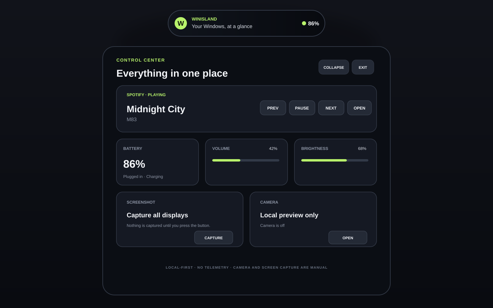

# WinIsland

A local-first, Dynamic Island-style desktop control centre for Windows 11. Designed around the Dell 15 260 with Intel Core Ultra 5 225H, and built for Windows 11 x64 PCs generally.



> This is a design preview, not a screenshot from a running build.

## Features

| Feature | What it does |
| --- | --- |
| Compact island | Top-centre pill that expands into a control panel; press `Esc` to collapse. |
| Battery | Live percentage, charging state, and power source. |
| Volume | Reads and changes the default Windows output volume, including mute. |
| Brightness | Reads and changes built-in display brightness through the Windows WMI monitor interface when the driver exposes it. |
| Spotify | Reads the active Spotify Windows media session and offers previous, play/pause, and next controls. No Spotify login or API key. |
| Screenshot | Captures all connected displays only after the user presses the button and chooses a save location. |
| Camera | Local camera preview and photo capture only after the user explicitly opens the camera. It stops when the island collapses or the app exits. |
| System tray | Reopen or exit WinIsland from the notification area. |

## Build the Windows app from GitHub (phone-friendly)

1. Open the repository's **Actions** tab.
2. Select **Build WinIsland** from the workflow list.
3. Press **Run workflow**, keep branch set to `main`, and press **Run workflow** again.
4. Wait for the workflow to finish. The build and unit-test job must be green.
5. The release job then publishes `v0.1.0`. Open [Releases](https://github.com/Vxn1r/Vxn1r-WinIsland/releases) and download `WinIsland-win-x64.zip`.

A push to `main` or a version tag also starts the workflow automatically. The manual workflow button is provided as a fallback.

## Install on Windows 11

1. On your Dell, download `WinIsland-win-x64.zip` from the latest successful release.
2. Extract the complete ZIP to a normal folder.
3. Double-click `Install.bat` and choose whether WinIsland should start when you sign in.
4. Open **Start** and search for **WinIsland**.

The installer copies the app to `%LOCALAPPDATA%\Programs\WinIsland` and adds Start Menu shortcuts. It does not require administrator permission. Use **Uninstall WinIsland** in the Start Menu to remove the app and its optional startup shortcut.

## Compatibility and limitations

- Windows 11 x64. The release is self-contained and includes the .NET runtime.
- Brightness support depends on the laptop panel and graphics driver exposing the WMI brightness interface. Some external monitors do not expose it.
- Spotify controls require the Spotify desktop app to publish a Windows media session.
- Camera access depends on Windows camera privacy settings. Camera frames remain local to the app.
- Multi-display screenshots use the Windows virtual desktop bounds.
- The release is not code-signed, so Windows SmartScreen may show an unknown-publisher warning. Verify the release and source before running it.

## Build from source

Install the .NET 10 SDK and run these commands from the repository root in PowerShell:

```powershell
dotnet restore .\WinIsland.sln
dotnet build .\WinIsland.sln --configuration Release
dotnet test .\tests\WinIsland.Tests\WinIsland.Tests.csproj --configuration Release

dotnet publish .\src\WinIsland\WinIsland.csproj `
  --configuration Release `
  --runtime win-x64 `
  --self-contained true `
  -p:PublishSingleFile=true `
  -p:IncludeNativeLibrariesForSelfExtract=true `
  --output .\publish
```

## Privacy and security

- No analytics, telemetry, advertisements, cloud sync, updater, or app backend.
- No Spotify OAuth flow, access token, or client secret.
- Screenshot capture is manual and opens a save dialog before capturing.
- Camera activation is manual, visibly indicated in the UI, and stops on collapse or exit.
- Screenshot and camera files are saved only to a location selected by the user.
- The application runs as the current user (`asInvoker`) and does not request administrator privileges.

Open source does not automatically mean secure. Review the code and dependency versions, and verify the release provenance before installing. Report security concerns privately where possible; see [SECURITY.md](SECURITY.md).

## License

MIT. See [LICENSE](LICENSE).
